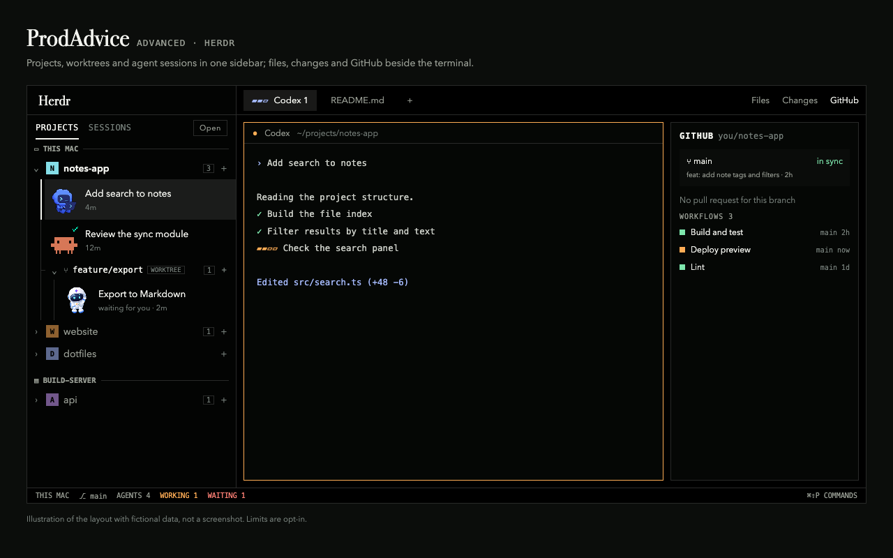

# ProdAdvice

A workspace layout for [Herdr](https://github.com/herdrdev/herdr-app) on macOS:
projects and agent sessions in one sidebar, animated agents, editable file tabs,
a file manager, Git changes, GitHub status and full-project search. English and
Russian interface.



The preview is an illustration with fictional data, not a screenshot.

## Two layouts

| | **ProdAdvice-Advanced** (recommended) | **ProdAdvice-Light** |
|---|---|---|
| Sidebar | PROJECTS / SESSIONS: projects, worktrees, sessions | Spaces + Workshop (agents) |
| Open a project | Cmd+N: computer → first session → folder | Herdr's own flow |
| Top tabs | all tabs of one checkout together | per Space |
| Right panels | Files, Changes, GitHub | Files, Changes |
| Go to (Cmd+P) | ProdAdvice picker | Herdr's picker |
| Look | ink and paper, square frames, pixel icons | the original rounded dark design |

Both have the same files, editor, search, Changes with commit suggestions,
animated agents, status bar, limits and conversation forks. New work goes into
Advanced; Light stays as the lighter, simpler variant. Each has a dark and a
day theme (`…-Night`, `…-Day`). See [APPEARANCE.md](APPEARANCE.md).

## What is included

- **prodsovet**: sidebars, agent cards and animations, tabs and menus, pane headers, GitHub panel, status bar with optional Claude/Codex limits.
- **my-files**: navigation, tree filter, create, rename, duplicate, copy/cut/paste, Finder reveal and macOS Trash.
- **file-tab**: text editor, Markdown preview, save, draft recovery and external editor actions.
- **find**: project filename/content search using ripgrep.
- **session_fork**: fork the focused Claude Code or Codex conversation into a new tab.

The mods work together; install the complete bundle.

## Projects in ProdAdvice-Advanced

- **PROJECTS** groups sessions by project. A thin rail ties a project's sessions
  and its git worktrees together; the current session lights its stretch of the
  rail. Projects on other machines appear under that machine's name.
- **SESSIONS** lists every agent session in one list, each card naming its
  project. Sort by status (needs you, done, working, resting) or in your own
  order: drag cards (and projects) to rearrange.
- **+** beside a project or worktree starts a session, a terminal or a worktree
  there. **Open** (Cmd+N) opens a new project on this Mac or a remote machine.

Details and stored state: [RECIPE.md](RECIPE.md).

## Requirements

- **macOS**, Herdr App **0.1.16** is the tested version. Other versions are unverified.
- `herdr-app`, `hc`, `python3` and `rg` on Herdr's PATH; `/usr/bin/trash` available.
- Open Herdr once so its built-in mods are installed. Stock dependencies are in `manifest.json`.
- Optional: Claude Code, Codex, Visual Studio Code or Obsidian for their respective actions.
- Tests additionally need Node.js 22+; there are no npm or pip dependencies for normal installation.

Windows/Linux file mutations are not supported by this release. Remote browsing
and file reading depend on Herdr's remote support; local macOS mutations do not
become remote operations. Remote forks require Python, `hc` and the agent on the remote machine.

## Install

Download or clone this repository, then run commands **from its root**.
Repository: https://github.com/Dan4eck/herdr-prodsovet

Read [ACCESS.md](ACCESS.md) and the source before installation: mods can execute
programs and read/write the files you work with.

```sh
python3 install.py                 # review the plan; does not write
python3 install.py --apply         # install files and merge new key bindings
for mod in prodsovet my-files file-tab find session_fork; do
  herdr-app check "$HOME/.config/herdr-app/mods/$mod" || break
done
```

If all five checks pass, switch to **ProdAdvice-Advanced** with Cmd+Shift+L or:

```sh
herdr-app do layout.switch '{"name":"ProdAdvice-Advanced"}'
```

The installer does not activate the layout or change agent settings. It uses
`HERDR_APP_HOME` when set; otherwise `~/.config/herdr-app`. `--home PATH` overrides
that location; use the same location for checks and subsequent uninstall.

Existing mod/layout/theme names cause a stop before writing anything. Existing
bindings with different actions also cause a stop; review the conflict and use
`--skip-conflicting-keys` to keep your bindings. Missing shortcuts can be assigned
manually afterwards. No `--force` overwrite mode is provided.

You can also ask a coding agent: "Read this repository's README, RECIPE and
ACCESS. Install the complete layout in my Herdr, preserving my mods and keys,
then check all five mods." Follow the collision rules above.

## Limits: explicit opt-in

Limits are **off by default**. To enable both at install time, add `--with-limits`
to the planned and applied install commands. After installation, alternatively
copy `mods/prodsovet/limits.example.json` to `limits.local.json` in the **installed**
mod folder and set `claude` and/or `codex` to `true`.

Claude reads your own `Claude Code-credentials` Keychain item and uses its OAuth
token only against `https://api.anthropic.com/api/oauth/usage`. Codex reads recent
local session logs under `CODEX_HOME` (default `~/.codex`). This is best-effort,
not a billing source: log values may be stale and provider endpoints/formats may
change. Refresh runs about every three minutes. No account data is shipped.
Remove or disable the local config to stop collection on the next refresh.

## Controls

| Context | Key/action | Result |
|---|---|---|
| Both layouts | Cmd+T / Ctrl+T | Terminal in the workspace root |
| Both layouts | Cmd+D / Cmd+Shift+D | Right/down split in that root |
| Global | Cmd+Shift+O | Project filename/content search |
| Terminal | Cmd+Shift+F | Fork current conversation |
| File tree | F2 | Rename selected item |
| File tree | Cmd+N / Cmd+Shift+N | Create file/folder |
| File tree | Cmd+Shift+G or path label | Enter a folder path |
| File tree | Cmd+C / X / V | Internal file copy/cut/paste |
| File tree | Cmd+Backspace | Trash confirmation |
| File tree | Up/down arrows in toolbar | Parent / selected directory |
| File tree | Enter | Send selected path to the agent |
| File editor | Cmd+S | Save |

Going to the parent selects the directory just left, so the down button returns
there. The tree filter covers expanded rows; full-project search is separate.
Copy/paste is an internal file clipboard, not Finder's clipboard.

## Conversation forks and agent status

Forking never guesses the newest conversation. Codex needs a title beginning
with its thread ID: inside Codex run `/title thread-id thread-name project-name`.
The resolver accepts a complete UUID or a uniquely matching long prefix in its
local session database. Claude needs the per-process session metadata supplied
by compatible Claude Code versions. The resolver checks identity twice before
launching a fork. Unsupported versions report an error instead of guessing.

Status cards show what Herdr reports. A running process with no reported
`working` status will not count as working. This package does not install
Codex/Claude lifecycle hooks or change their global configurations.

## Commit message suggestions

Both layouts' Changes panels suggest a commit subject from the current local
diff using GPT-6-Luna with low reasoning effort through an installed, logged-in
Codex CLI. A Conventional Commits subject (`fix:`, `feat:`, `refactor:`, etc.)
appears directly in the message field after changes settle, with no shortcut
hint. Enter or Commit then commits all changes, as before.
Typing your own message takes precedence. Changed diffs invalidate old
suggestions; identical diffs reuse the result. Failed requests have a Retry link.
Remote repositories keep manual commit messages.

The CLI runs ephemerally in a temporary directory with a read-only sandbox,
without user configuration, hooks or shell tools. A bounded diff excerpt and
file names are sent through your Codex account; known credential-file contents
and binary contents are omitted. Large changes may be summarized incompletely.
Generation uses your normal Codex allowance. Review the proposed message before
committing; generating or prefilling a message does not stage or commit files.

## Limits of this release

File tree: one selected item at a time, no drag-and-drop. Directory listing is capped at
500 entries per folder and 5,000 total. File loading uses Herdr's text-file API
(1 MiB limit in the tested version). Saves detect changes on disk; open dirty
files block rename/move/Trash. Cross-volume cut/move fails without deleting the
source; use copy and then Trash. Changes view and Git decorations need Git.

The public build includes the same mascot sprite strips as the original personal
mod: Codex companion, Claude's Clawd, Gemini astronaut, Hermes girl and the
generic robot for unknown agents. See [NOTICE](NOTICE) for attribution.

## Updates and uninstall

Update from a newer copy of this repository, run from its root:

```sh
python3 install.py --update            # review the plan; does not write
python3 install.py --update --apply    # replace the old version
```

An update replaces only files the installer wrote and nobody changed since,
removes files the new version no longer has, and adds new key bindings. If you
edited a package file, it stops before writing and names the file: save your
edits elsewhere, put the original back (or delete the file) and run it again.
`limits.local.json` is yours and is kept. Updating from 0.3 renames the layouts
(ProdAdvice → ProdAdvice-Light, ProdAdvice2 → ProdAdvice-Advanced); the
installer prints the switch command if your window still uses an old name.

```sh
python3 install.py --uninstall           # inspect removal
python3 install.py --uninstall --apply   # remove unchanged owned files/bindings
```

Save your documents and switch to another layout before uninstalling. Uninstall
refuses to delete modified package files; your own files, runtime state, an
edited `limits.local.json` and bindings you changed stay. Files Herdr's own
checks create in a mod folder (`jsconfig.json`, `gpui-kit.d.ts`) keep that
folder. The receipt `.herdr-prodsovet-install.json` tracks ownership; do not
publish it.

## Development and publication

Run `python3 -B verify.py` on macOS. Tests use temporary files; one Trash test
moves its own fixture to the system Trash and brings it back for cleanup.
After source changes, run the five native Herdr checks and try the affected UI.
`filesystem.js` in `my-files` is canonical; the copies in the three other mods
must match except for their generated header. `verify.py` checks this.

See [RECIPE.md](RECIPE.md) for architecture, [VALIDATION.md](VALIDATION.md) for
what has actually been checked, and [PUBLISHING.md](PUBLISHING.md) for release steps.

Apache-2.0 for project code/custom contributions; third-party notices and asset
exceptions are in [NOTICE](NOTICE) and `licenses/`. Unofficial community project.
