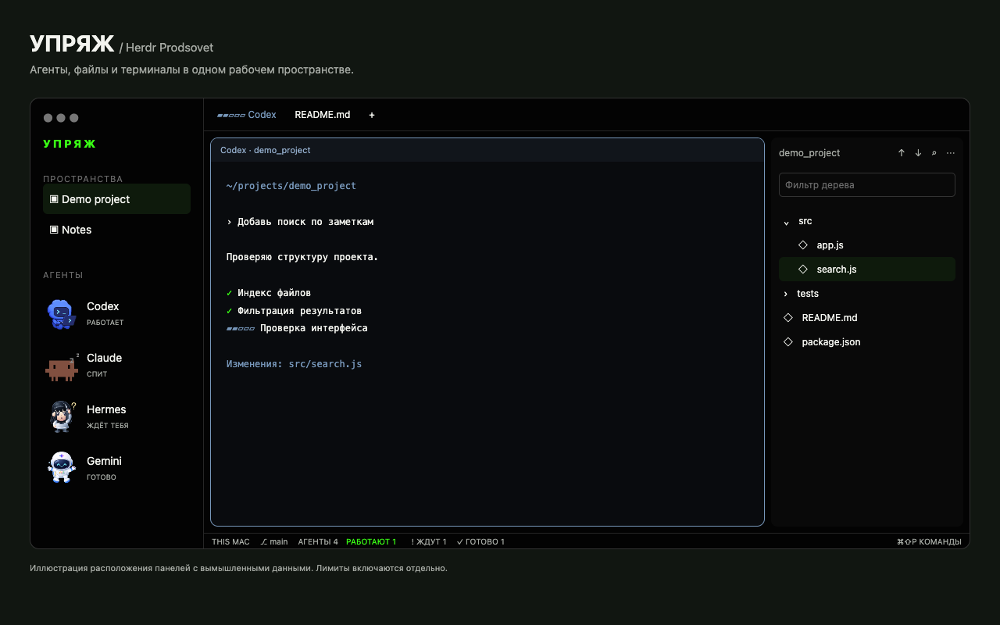

# УПРЯЖ / Herdr Prodsovet

A dark Herdr workspace with spaces and animated agents at the left, terminal or
file tabs in the center, a file tree at the right and a compact bottom status
strip. Russian labels, workspace-aware navigation and optional account limits.

## What you see

The root is a row. Left sidebar: 241 px, min 44 / max 480; 46 px brand header,
a weighted spaces/agents column and 69 px stock workspace footer. Main work
column: 42 px tabs, flexible body, 20 px status strip. Body has 8 px padding/gap;
right panel 294 px, min 280 / max 900, a files/changes stack. Pane headers are
30 px with radius 10, gap 8 and a one-pixel border. Terminal padding is 14/12.
Status type is 10 px with 10 px horizontal spacing. Other type sizes stay in the
individual mods; use their current source rather than globally scaling fonts.

Dark palette: canvas/chrome #030303, background #090909, foreground #f3f4ef,
border #262626, accent #39ff14. Focused Codex panes use #090b0e / #7797ba;
Claude panes use #0b0a09 / #b3927b. Light mode delegates to the shipped paper theme.

The illustration in preview.png is made from preview.html and fictional data;
it is not native rendering evidence. The artwork files are the shipped sprites.

## How it behaves

Working agents animate; blocked agents request attention; done agents show a
completed state; idle agents sleep. Each kind has four 16-frame horizontal PNG
strips. Codex uses the original Codex companion; Claude uses Clawd from the
Claude Code welcome screen. Gemini uses the custom astronaut, Hermes the
adapted Nous girl. Unknown kinds use the robot. All sprite strips match the
installed personal mod.
Pane/tab status scanners use the small animated bars defined in creatures.js.
Cards focus their agent; grouping, sorting, pinning and attention state use Herdr
metadata. The blocked count pulses in the status strip. Agent counters require
Herdr to report the corresponding state; do not infer activity from a live PID.

Opening a file creates/focuses a file tab in its originating space. Roots are
persisted per space, separate from the tree's browsed location. Switching to a
file tab or old home-directory terminal must not change the project root.
Cmd/Ctrl+T and split commands explicitly pass the root and space. Tree Up goes
to the parent and selects the directory just left; Down enters the selected
directory. Folder clicks expand/collapse. Icon tooltips are intentionally absent.
The context menu has file operations, no open-folder-here/goto/workspace entries.
The path label and Cmd+Shift+G retain explicit folder navigation.

File operations reject overwrites. Rename/move update open descendants; dirty
or saving documents block conflicting operations. Trash requires confirmation;
trashed documents remain visible but cannot be saved. Drafts survive reloads.
The editor detects conflicting disk changes. Tree filter applies to expanded
rows; full search uses ripgrep. Keyboard bindings are listed in README/keys.json.

Session forks resolve exact conversation identity, verify it twice and start a
new agent tab in the captured space/cwd. Errors stay in the popup. No guessing
by newest conversation. Limits are disabled unless limits.local.json explicitly
enables each source. Missing credentials/changed APIs should leave a source
unavailable while the rest of the interface remains usable.

## Built from

Node tree: root -> sidebar(brand, sidebar-lists(spaces, agents), sidebar-footer)
and work(tabs, work-body(main, panel(panel-body(files, changes))), status).
See layouts/prodsovet.json for exact weights and content props.

prodsovet implements brand, agents, pane, status, toast, zoo, tabs, new-menu and
tab-menu roles. The default pane/header role and overlay role are selected by
props. my-files implements tree/menu/dialog views; file-tab is an editor view;
find and session_fork are popup mods. The layout's toast delegates to prodsovet.

Stock dependencies: spaces, workspace-chrome, pane, tabs, files, changes,
worktree; stock icons in icons/. These remain supplied by Herdr, not vendored.
Runtime modules: herdr, gpui-kit, gpui-base. No DOM, Node or browser inside mods.
Local imports cannot leave the mod directory. filesystem.js is canonical in
my-files and copied verbatim with a generated header into three dependent mods.

Herdr APIs include spaces/panes/focused/terminals/agents/knownAgents, shared and
setShared, props/theme/settings/keys/window/layout, readTextFile/writeTextFile,
exec, run, nextCommand, openOverlay/closeOverlay, notify and setAgentOrder.
Commands include tab.new/close/focus, terminal.open, agent focus, layout changes,
window controls and custom workspace-aware terminal/split commands. Consult the
source and installed herdr.d.ts for exact signatures.

Programs: Python 3, hc, rg, Git, shell utilities, macOS open/pbcopy/pbpaste/trash;
security only for opted-in Claude limits. See ACCESS.md for data flow. Uses
macOS renamex_np(RENAME_EXCL) to prevent destination clobbering. Python standard
library only. Runtime state is supplied by each user's Herdr, never by a package.

## Watch out

Pin compatible Herdr APIs; tested on 0.1.15, not all future releases. Do not copy
personal settings/state or replace a user's keys wholesale. Keep exact mod names
unless rewriting every reference and key scope together. Native check does not
exercise async callbacks, all roles or real interactions. A terminal PID is not
a conversation ID. Codex title format and Claude session metadata are external
prerequisites. Limit collection relies on provider-specific formats, not stable
billing APIs. The file tree has 500-per-directory / 5,000-total caps; text reads
are limited by Herdr to 1 MiB in the tested version. No multi-select/drag-drop or
remote file mutations. Cross-volume move fails; source must survive.

The public mascot artwork matches the personal build; retain NOTICE and all
license files. Generated gpui-kit types and private backups are
not source files to redistribute. Agent lifecycle hooks are not installed here.

## Done when

1. Package verification and regression tests pass on macOS.
2. Each of the five mods passes herdr-app check.
3. A fresh install adds only package files/keys, detects collisions and can be
   uninstalled without deleting unrelated keys/state or modified files.
4. With no local limits config, neither credentials nor session logs are read.
5. In native Herdr: open a document, create a terminal, switch spaces and verify
   each root; navigate Up/Down; edit/save/rename; try a Trash confirmation; search.
6. Exercise all four agent states and inspect narrow window clipping. Confirm
   enabled limits use the installing user's account, and test fork prerequisites.

Items 5-6 are a manual acceptance procedure, not a claim that every case was
rerun for this distribution. Actual evidence is recorded in VALIDATION.md.
